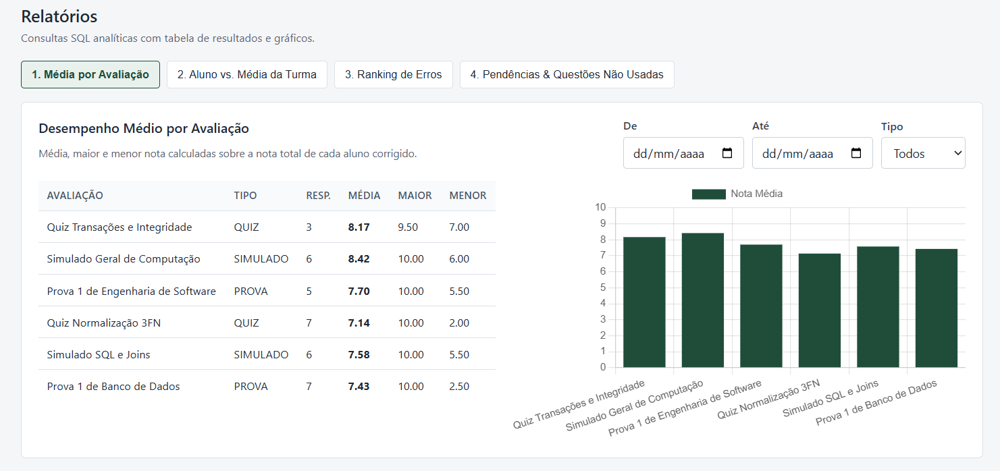
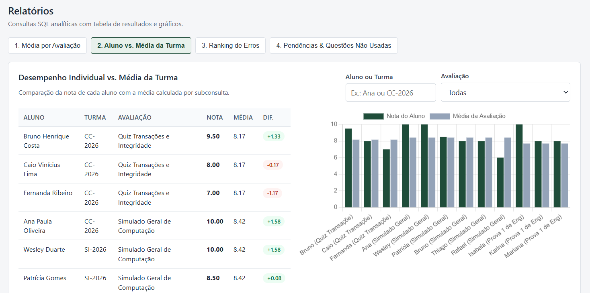
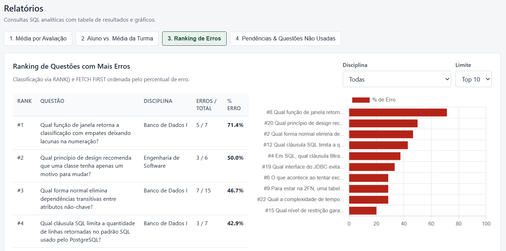
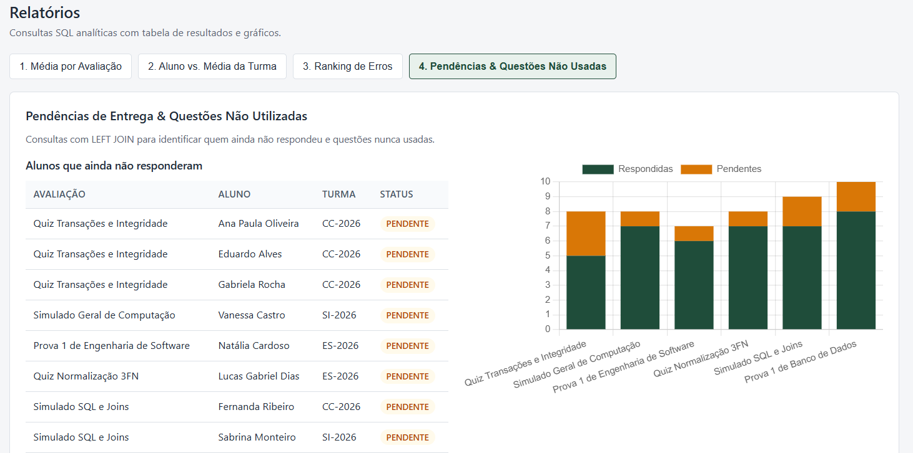

# Sistema de Avaliações

Projeto da disciplina de Banco de Dados I (UEL - Prof. Dr. Anderson Paulo Avila Santos).

## Integrantes

- Eder Medeiros (`edermedeiroos`)
- Matheus Yudi (`matheusyudienomoto`)

## Natureza do sistema e particularidade

Escolhemos a natureza de **Avaliação de aprendizagem** (provas, simulados e quizzes).

Como particularidade dessa natureza, cada questão tem um valor definido por avaliação (`avaliacao_questao.valor`), permitindo reutilizar a mesma questão em provas diferentes com pesos diferentes. Quando o aluno envia as respostas, as questões de múltipla escolha são corrigidas automaticamente, as de texto livre ficam aguardando nota do professor e a nota total do aluno é calculada somando `nota_obtida` nas respostas.

## Modelagem e arquivos do banco

- DER: [docs/der.svg](docs/der.svg)
- Esquema relacional e justificativa da 3FN: [docs/esquema-relacional.md](docs/esquema-relacional.md)
- DDL: [database/schema.sql](database/schema.sql)
- Carga de teste: [database/carga.sql](database/carga.sql)
- SQL dos relatórios: [database/relatorios.sql](database/relatorios.sql)

## Tecnologias e estrutura

- Banco: PostgreSQL (PK, FK, `NOT NULL`, `UNIQUE`, `CHECK` e índice único parcial).
- Back-end: Java 17 + Spring Boot + JDBC (`JdbcTemplate` e classes DAO), sem JPA/Hibernate.
- Camadas: `controller` -> `service` -> `dao` -> PostgreSQL.
- Front-end: HTML, CSS e JS em `src/main/resources/static/`, com gráficos usando Chart.js.

## Como rodar o sistema

Pré-requisitos: PostgreSQL, JDK 17+ e Maven.

1. Crie o banco vazio e rode os scripts `schema.sql` e `carga.sql` nessa ordem:

```bash
psql -U postgres -c "CREATE DATABASE sistema_avaliacoes;"
psql -U postgres -d sistema_avaliacoes -f database/schema.sql
psql -U postgres -d sistema_avaliacoes -f database/carga.sql
```

2. O projeto usa por padrão o banco `jdbc:postgresql://localhost:5432/sistema_avaliacoes` com usuário `postgres` e senha `postgres` (configurado em `src/main/resources/application.properties`). Se a sua senha ou porta local for diferente, defina as variáveis de ambiente ou ajuste o arquivo:

```bash
export DB_URL=jdbc:postgresql://localhost:5432/sistema_avaliacoes
export DB_USER=postgres
export DB_PASS=sua_senha
```

3. Suba a aplicação:

```bash
mvn spring-boot:run
```

4. Acesse `http://localhost:8080`.

Contas para teste (senha `Uel@Bd2026` para todas):
- Professor: `anderson@uel.br`
- Aluna (`CC-2026`): `ana.paula@uel.br`

## Relatórios

### 1. Desempenho médio por avaliação
- **Objetivo:** mostrar nota média, maior e menor nota das avaliações corrigidas, com filtros por período e tipo.
- **Recursos SQL:** `INNER JOIN`, subconsulta (`SUM` por aluno), `COUNT`, `AVG`, `MAX`, `MIN`, `GROUP BY`, `HAVING`, `WHERE` com `BETWEEN` e `IN`.
- **Tela:** 

```sql
SELECT a.id AS avaliacao_id, a.titulo, a.tipo, a.data_aplicacao,
       COUNT(notas.usuario_id) AS total_respondentes,
       ROUND(AVG(notas.nota_total), 2) AS nota_media,
       MAX(notas.nota_total) AS maior_nota,
       MIN(notas.nota_total) AS menor_nota
FROM avaliacao a
INNER JOIN (
    SELECT r.avaliacao_id, r.usuario_id, SUM(r.nota_obtida) AS nota_total
    FROM resposta r
    INNER JOIN avaliacao_usuario au
        ON au.avaliacao_id = r.avaliacao_id AND au.usuario_id = r.usuario_id
    WHERE au.status = 'CORRIGIDA'
    GROUP BY r.avaliacao_id, r.usuario_id
) notas ON notas.avaliacao_id = a.id
WHERE a.data_aplicacao BETWEEN '2026-10-01' AND '2026-11-30'
  AND a.tipo IN ('PROVA', 'SIMULADO', 'QUIZ')
GROUP BY a.id, a.titulo, a.tipo, a.data_aplicacao
HAVING COUNT(notas.usuario_id) >= 1
ORDER BY a.data_aplicacao DESC, a.id DESC;
```

### 2. Desempenho individual vs. média da avaliação
- **Objetivo:** comparar a nota de cada aluno com a média geral da avaliação, podendo filtrar por nome ou turma.
- **Recursos SQL:** `INNER JOIN`, `LEFT JOIN`, subconsulta para calcular a média da avaliação, `SUM`, `AVG`, `GROUP BY`, `ORDER BY`, `WHERE` com `LIKE`.
- **Tela:** 

```sql
SELECT a.id AS avaliacao_id, a.titulo AS avaliacao_titulo,
       u.id AS usuario_id, u.nome AS aluno_nome,
       COALESCE(t.codigo, '-') AS turma_codigo,
       SUM(r.nota_obtida) AS nota_aluno,
       ROUND((
           SELECT AVG(sub.total_aluno)
           FROM (
               SELECT SUM(r2.nota_obtida) AS total_aluno
               FROM resposta r2
               INNER JOIN avaliacao_usuario au2
                   ON au2.avaliacao_id = r2.avaliacao_id AND au2.usuario_id = r2.usuario_id
               WHERE r2.avaliacao_id = a.id AND au2.status = 'CORRIGIDA'
               GROUP BY r2.usuario_id
           ) sub
       ), 2) AS media_turma
FROM avaliacao_usuario au
INNER JOIN avaliacao a ON a.id = au.avaliacao_id
INNER JOIN usuario u ON u.id = au.usuario_id
LEFT JOIN turma t ON t.id = u.turma_id
INNER JOIN resposta r ON r.avaliacao_id = au.avaliacao_id AND r.usuario_id = au.usuario_id
WHERE au.status = 'CORRIGIDA'
  AND (LOWER(u.nome) LIKE LOWER('%') OR LOWER(COALESCE(t.codigo, '')) LIKE LOWER('%'))
GROUP BY a.id, a.titulo, a.data_aplicacao, u.id, u.nome, t.codigo
ORDER BY a.data_aplicacao DESC, nota_aluno DESC, u.nome;
```

### 3. Ranking das questões com mais erros
- **Objetivo:** listar até 10 questões com maior percentual de erro (nota abaixo de 50% do valor), filtrável por disciplina.
- **Recursos SQL:** `INNER JOIN`, `COUNT`, `SUM`, `GROUP BY`, `HAVING`, `RANK()`, `ORDER BY` e `FETCH FIRST 10 ROWS ONLY`.
- **Tela:** 

```sql
SELECT RANK() OVER (
           ORDER BY (SUM(CASE WHEN r.nota_obtida < (aq.valor * 0.5) THEN 1 ELSE 0 END)::numeric * 100.0 / COUNT(*)) DESC,
                    SUM(CASE WHEN r.nota_obtida < (aq.valor * 0.5) THEN 1 ELSE 0 END) DESC
       ) AS posicao,
       q.id AS questao_id, q.enunciado, q.disciplina,
       COUNT(*) AS total_respostas,
       SUM(CASE WHEN r.nota_obtida < (aq.valor * 0.5) THEN 1 ELSE 0 END) AS total_erros,
       ROUND(SUM(CASE WHEN r.nota_obtida < (aq.valor * 0.5) THEN 1 ELSE 0 END)::numeric * 100.0 / COUNT(*), 1) AS percentual_erro
FROM resposta r
INNER JOIN avaliacao_questao aq
    ON aq.avaliacao_id = r.avaliacao_id AND aq.questao_id = r.questao_id
INNER JOIN questao q ON q.id = r.questao_id
WHERE r.nota_obtida IS NOT NULL
GROUP BY q.id, q.enunciado, q.disciplina
HAVING COUNT(*) >= 3
ORDER BY percentual_erro DESC, total_erros DESC, q.id
FETCH FIRST 10 ROWS ONLY;
```

### 4. Pendências de entrega e questões não utilizadas
- **Objetivo:** exibir entregas vs. pendências por avaliação e listar alunos que ainda não responderam e questões nunca usadas.
- **Recursos SQL:** `LEFT JOIN` com `IS NULL`, `COUNT`, `SUM`, `GROUP BY`, `ORDER BY`.
- **Tela:** 

```sql
-- Alunos pendentes
SELECT au.avaliacao_id, a.titulo AS avaliacao_titulo,
       au.usuario_id, u.nome AS aluno_nome,
       COALESCE(t.codigo, '-') AS turma_codigo, au.status
FROM avaliacao_usuario au
INNER JOIN avaliacao a ON a.id = au.avaliacao_id
INNER JOIN usuario u ON u.id = au.usuario_id
LEFT JOIN turma t ON t.id = u.turma_id
LEFT JOIN resposta r
    ON r.avaliacao_id = au.avaliacao_id AND r.usuario_id = au.usuario_id
WHERE r.id IS NULL
ORDER BY a.data_aplicacao DESC, u.nome;

-- Questoes nunca usadas
SELECT q.id, q.enunciado, q.tipo, q.disciplina, q.dificuldade, u.nome AS criado_por_nome
FROM questao q
INNER JOIN usuario u ON u.id = q.criado_por
LEFT JOIN avaliacao_questao aq ON aq.questao_id = q.id
WHERE aq.questao_id IS NULL
ORDER BY q.id;
```
