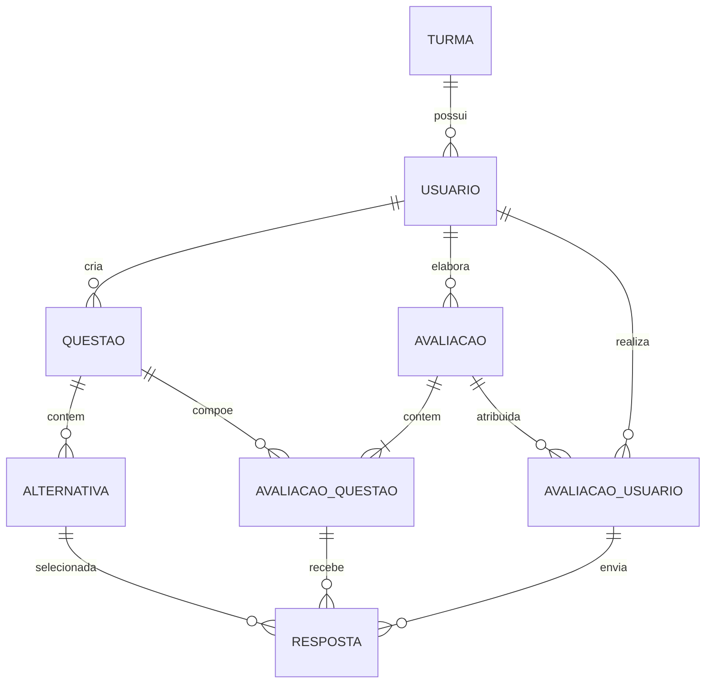

# Esquema Relacional e Normalizacao (3FN)

## 1. Diagrama Entidade-Relacionamento

O DER esta disponivel em [der.svg](der.svg). Abaixo esta a visao geral das entidades e relacionamentos:

## 2. Esquema Relacional

- **turma** (<u>id</u>, codigo, nome, ano_semestre)
  - `codigo` UNIQUE
- **usuario** (<u>id</u>, nome, email, senha, perfil, *turma_id*, ativo)
  - `email` UNIQUE
  - `turma_id` referencia `turma(id)`
- **questao** (<u>id</u>, enunciado, tipo, disciplina, dificuldade, *criado_por*, criado_em)
  - `criado_por` referencia `usuario(id)`
- **alternativa** (<u>id</u>, *questao_id*, letra, texto, correta)
  - `questao_id` referencia `questao(id)`
  - UNIQUE (`questao_id`, `letra`) e indice unico parcial garantindo no maximo uma alternativa com `correta = TRUE` por questao
- **avaliacao** (<u>id</u>, titulo, descricao, tipo, data_aplicacao, hora_inicio, hora_fim, *criado_por*)
  - `criado_por` referencia `usuario(id)`
- **avaliacao_questao** (<u>*avaliacao_id*</u>, <u>*questao_id*</u>, ordem, valor)
  - `avaliacao_id` referencia `avaliacao(id)`
  - `questao_id` referencia `questao(id)`
  - UNIQUE (`avaliacao_id`, `ordem`)
- **avaliacao_usuario** (<u>*avaliacao_id*</u>, <u>*usuario_id*</u>, status, enviada_em)
  - `avaliacao_id` referencia `avaliacao(id)`
  - `usuario_id` referencia `usuario(id)`
- **resposta** (<u>id</u>, *avaliacao_id*, *usuario_id*, *questao_id*, *alternativa_id*, texto_resposta, nota_obtida, *corrigida_por*, corrigida_em, respondida_em)
  - (`avaliacao_id`, `usuario_id`) referencia `avaliacao_usuario(avaliacao_id, usuario_id)`
  - (`avaliacao_id`, `questao_id`) referencia `avaliacao_questao(avaliacao_id, questao_id)`
  - `alternativa_id` referencia `alternativa(id)`
  - `corrigida_por` referencia `usuario(id)`
  - UNIQUE (`avaliacao_id`, `usuario_id`, `questao_id`)

## 3. Justificativa da 3FN

O esquema esta na **Terceira Forma Normal (3FN)**: todos os atributos sao atomicos (1FN), nas chaves compostas (`avaliacao_questao` e `avaliacao_usuario`) todos os atributos nao-chave dependem da chave completa (2FN) e nao ha dependencias transitivas nem dados derivados gravados (3FN), ja que a nota total do aluno na avaliacao e calculada dinamicamente via `SUM(nota_obtida)` em `resposta` em vez de ser armazenada em `avaliacao_usuario`.
